<div align="center">

<a href="https://nasaspace.site">
  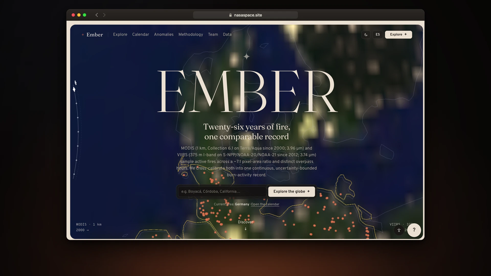
</a>

# Ember

### Twenty-six years of fire, one comparable record.

**Ember harmonizes NASA's MODIS and VIIRS active-fire records into a single series from 2000 to today,<br>and turns it into early-warning alerts that name who to notify.**

<br>

<a href="https://nasaspace.site"></a>
<a href="https://github.com/IngeNelsonG/NASA_CHALLENGE_2026/actions/workflows/ci-cd.yml"></a>
<a href="https://www.spaceappschallenge.org/2026/challenges/harmonization-of-modis-and-viirs-hot-spots/"></a>
<a href="https://www.spaceappschallenge.org/2026/find-a-team/ustacode1/?tab=members"></a>


<br><br>

[**Open the app**](https://nasaspace.site) &nbsp;·&nbsp;
[**Watch the 30-second demo**](https://youtu.be/uZ3F6bVv9zg) &nbsp;·&nbsp;
[**How it works**](https://nasaspace.site/metodologia) &nbsp;·&nbsp;
[**Developer guide**](docs/development/setup.md) &nbsp;·&nbsp;
[**Scientific transparency (ES)**](docs/methodology/TRANSPARENCIA_CIENTIFICA_Y_ESTADISTICA.md)

<br>

<a href="https://nasaspace.site">
  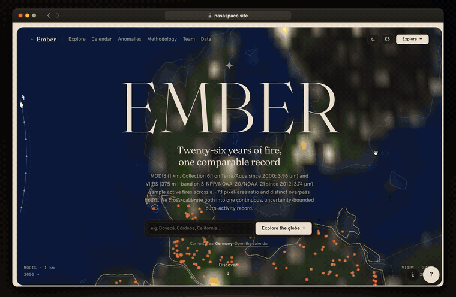
</a>

<sub>The whole app in 12 seconds, recorded at <a href="https://nasaspace.site">nasaspace.site</a>.</sub>

</div>

<br>

<table>
<tr>
<td align="center"><h3>26 years</h3><sub>Nov 2000 → today,<br>one comparable series</sub></td>
<td align="center"><h3>2.1 M</h3><sub>fire detections in the<br>Colombia point archive</sub></td>
<td align="center"><h3>234</h3><sub>countries with monthly<br>harmonized totals</sub></td>
<td align="center"><h3>4,167</h3><sub>states, provinces and<br>departments</sub></td>
<td align="center"><h3>≈100</h3><sub>official authority portals<br>in the alert directory</sub></td>
<td align="center"><h3>249 ✓</h3><sub>backend tests,<br>90.8 % coverage</sub></td>
</tr>
</table>

## Contents

- [The problem](#-the-problem)
- [What Ember does](#-what-ember-does)
- [How it works](#-how-it-works)
- [From anomaly to alert](#-from-anomaly-to-alert)
- [Gallery](#-gallery)
- [Data sources](#%EF%B8%8F-data-sources)
- [Built with](#%EF%B8%8F-built-with)
- [Architecture](#%EF%B8%8F-architecture)
- [Run it locally](#-run-it-locally)
- [Quality, accessibility and honesty](#-quality-accessibility-and-honesty)
- [Use of AI](#-use-of-ai)
- [Team](#-team)

## 🔥 The problem

Two NASA instruments have been watching fires from orbit for a quarter of a century, but their numbers cannot simply be stacked together.

| | **MODIS** | **VIIRS** |
|---|---|---|
| Satellites | Terra (2000→), Aqua (2002→) | Suomi NPP (2012→), NOAA-20, NOAA-21 |
| Fire pixel | 1 km | 375 m |
| What changes | — | sees many more, smaller fires: one MODIS pixel can hold several VIIRS detections |

Plot raw detection counts from 2000 to 2026 and fire seems to "explode" in 2012. It didn't; the sensor changed. Any year-to-year comparison, trend or alert threshold built on mixed counts is wrong from the start.

### Built for the world, deepest in Colombia

Ember works for every country on Earth: the harmonized record, the seasonal anomalies and the alerts cover 234 countries. We are a Colombian team, so we went deepest at home: every detection since 2000, alerts for each department, and the national and regional authorities that respond (UNGRD, IDEAM and the regional autonomous corporations). Colombia is our proof that a global record can become local action; the same method is ready for any country.

## ✨ What Ember does

<table>
<tr>
<td width="50%" valign="top">
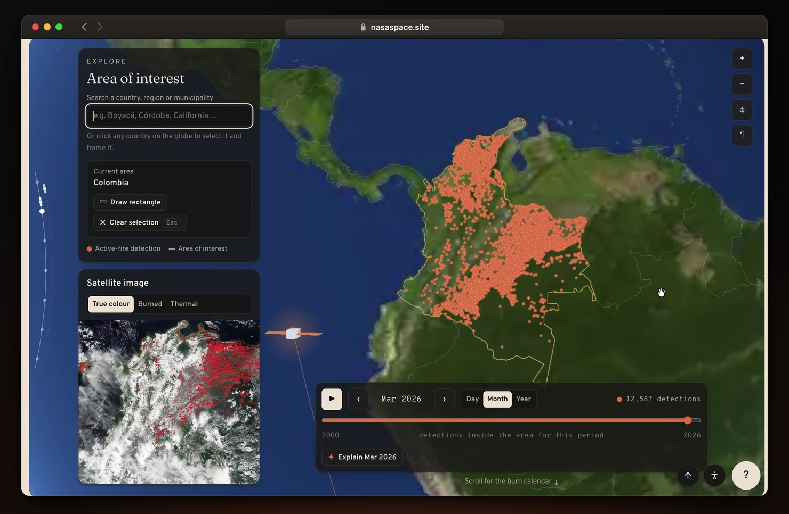
<p><b>Explore any place on Earth.</b> Search a country, region or municipality, or draw a box. The 3D globe shows every detection, the real satellites in orbit and the day/night line; the side panel shows NASA GIBS imagery of that very day.</p>
</td>
<td width="50%" valign="top">
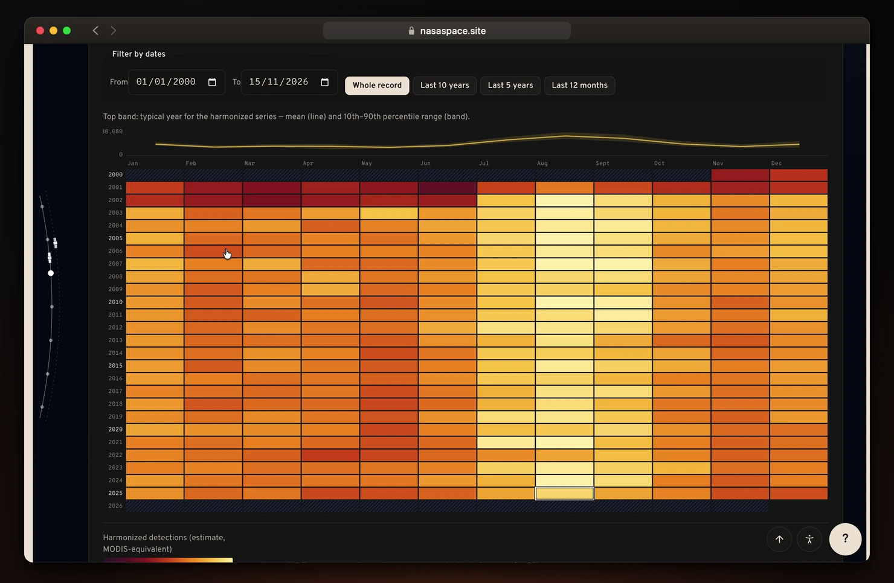
<p><b>See when it burns.</b> A burn-activity calendar (day, week or month) of the harmonized series, with the typical year and its 10th–90th percentile band. Gaps with no satellite observation are hatched, never shown as zero.</p>
</td>
</tr>
<tr>
<td width="50%" valign="top">
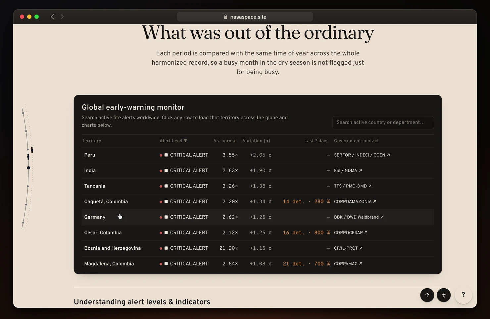
<p><b>Know when it is unusual.</b> A global early-warning monitor ranks countries and Colombian departments by how far they are from their own normal for that season, in standard deviations (σ).</p>
</td>
<td width="50%" valign="top">
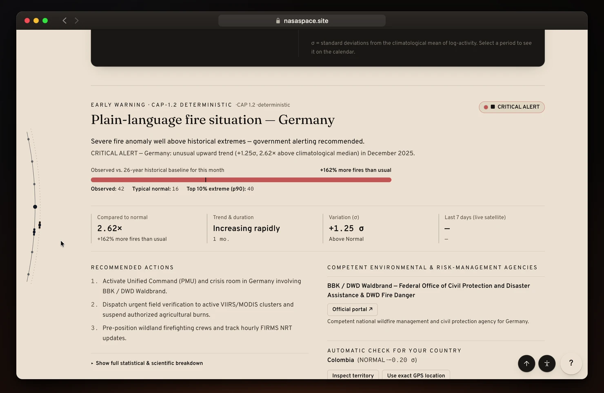
<p><b>Know who to call.</b> Each alert becomes a plain-language bulletin (CAP-1.2 style) with recommended actions and the competent civil-protection or environmental authority, and anyone can subscribe to email alerts.</p>
</td>
</tr>
</table>

Also inside: an **El Niño / La Niña panel** (NOAA ONI, shown as context, never as a proven cause), **CSV downloads** of exactly what is on screen, an **AI help assistant** (clearly labelled), and a dedicated **[methodology page](https://nasaspace.site/metodologia)** with every formula, assumption and limit.

## 🧪 How it works

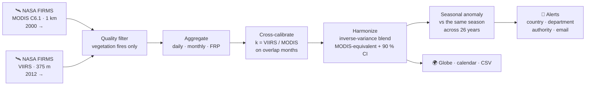

1. **Data.** NASA FIRMS standard products for MODIS Collection 6.1 (Terra, Aqua) and VIIRS 375 m (S-NPP, NOAA-20, NOAA-21), plus FIRMS near-real-time data for the most recent days.
2. **Filter.** Only vegetation fires; volcanoes, gas flares, industrial sources and low-confidence detections are removed.
3. **Aggregate.** Daily and monthly detection counts and mean fire radiative power (FRP, MW) per country and subdivision.
4. **Cross-calibrate.** The VIIRS/MODIS ratio $k$ is measured on the months where both sensors exist (from February 2012), shrunk toward a prior when the overlap is short:

$$w = \frac{n}{n+24}, \qquad k_{\text{post}} = w\,k_{\text{obs}} + (1-w)\,k_{\text{prior}}$$

5. **Harmonize.** MODIS ($M$) and rescaled VIIRS ($V/k$) are merged by inverse variance, with a 90 % interval. The result is in **MODIS-equivalent detections**, so 2005 and 2023 are on the same scale:

$$H = \frac{w_M\,M + w_V\,V/k}{w_M + w_V}$$

Before 2012 only MODIS existed, and the record says so.

<details>
<summary><b>The physics behind a fire pixel</b> (Planck, Wien, FRP)</summary>
<br>

Fires at 600–1200 K peak in the mid-infrared, far from the ~300 K background that peaks near 10 µm (Wien's law), which is why both sensors detect fire around 3.7–4 µm:

$$\lambda_{\max} = \frac{2897.8\ \mu\text{m·K}}{T}$$

Fire radiative power comes from the mid-infrared excess over the background (Wooster et al., 2003):

$$\text{FRP} = \frac{\sigma}{a}\sum \left(L_{\text{MIR}} - L_{\text{bg}}\right)$$

Full derivations, including Planck's law and the role of GOES geostationary data, are in the [scientific transparency document](docs/methodology/TRANSPARENCIA_CIENTIFICA_Y_ESTADISTICA.md) and on the [methodology page](https://nasaspace.site/metodologia).
</details>

## 🚨 From anomaly to alert

A busy month in the normal dry season is not news. Ember compares each period **with the same time of year across the whole record**, on a log scale:

$$Y(t) = \ln\bigl(1 + H(t)\bigr), \qquad z(t) = \frac{Y(t) - \mu_s(m)}{\max\bigl(\sigma_s(m),\ 0.25\bigr)}$$

and backs it with a robust score that a single extreme year cannot distort:

$$z_{\text{rob}} = \frac{X - M_m}{\max\bigl(\text{MAD}_m,\ \text{IQR}/1.349,\ 1\bigr)}, \qquad \text{MAD}_m = 1.4826\ \text{median}\,|X - M_m|$$

When activity breaks the norm, Ember raises an alert by **country** or **Colombian department**, writes a plain-language bulletin, names the authority from a directory of about 100 official portals (UNGRD, IDEAM and the regional autonomous corporations in Colombia, and national agencies worldwide), and sends it to email subscribers.

## 📸 Gallery

<table>
<tr>
<td width="50%">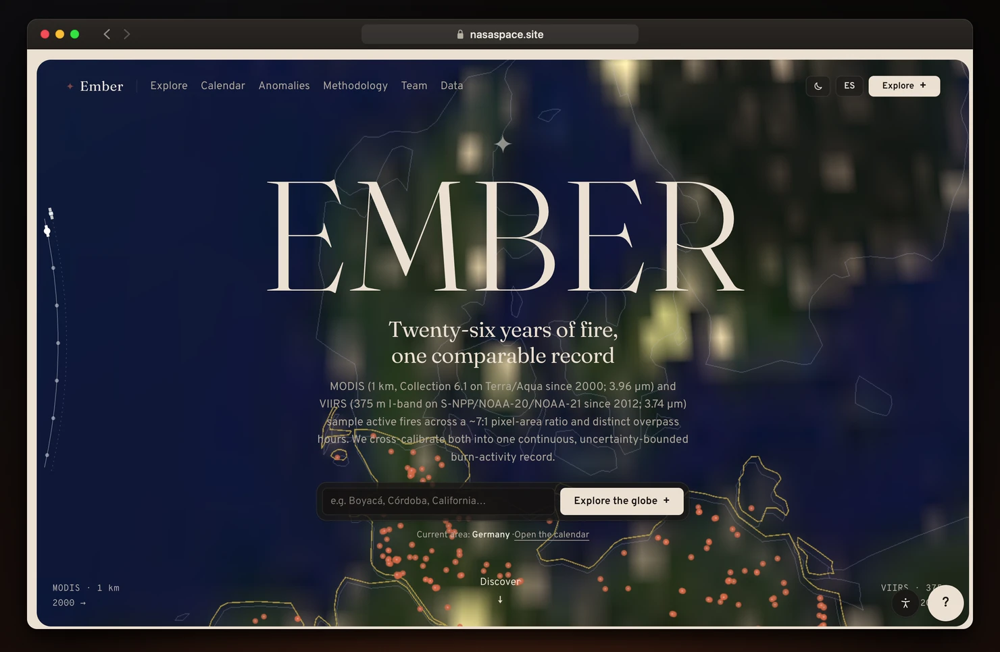</td>
<td width="50%">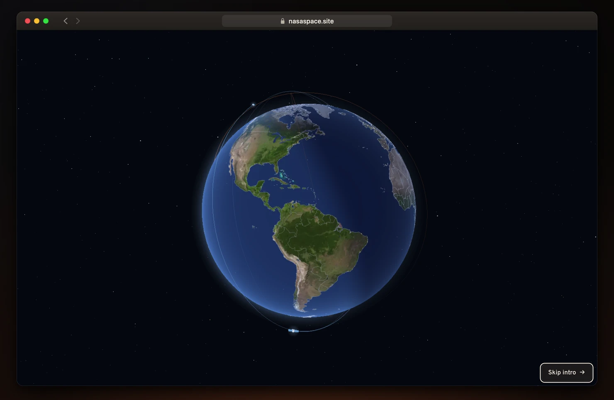</td>
</tr>
<tr>
<td align="center"><sub>Landing: twenty-six years of fire, one comparable record</sub></td>
<td align="center"><sub>One WebGL Earth shared by the intro, the landing and the explorer</sub></td>
</tr>
<tr>
<td width="50%">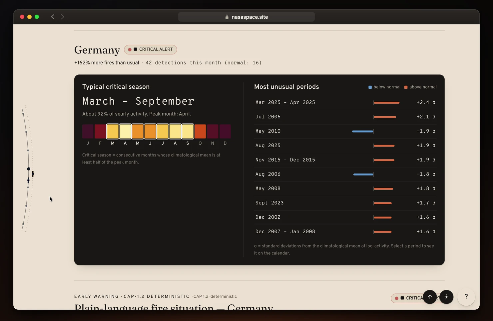</td>
<td width="50%">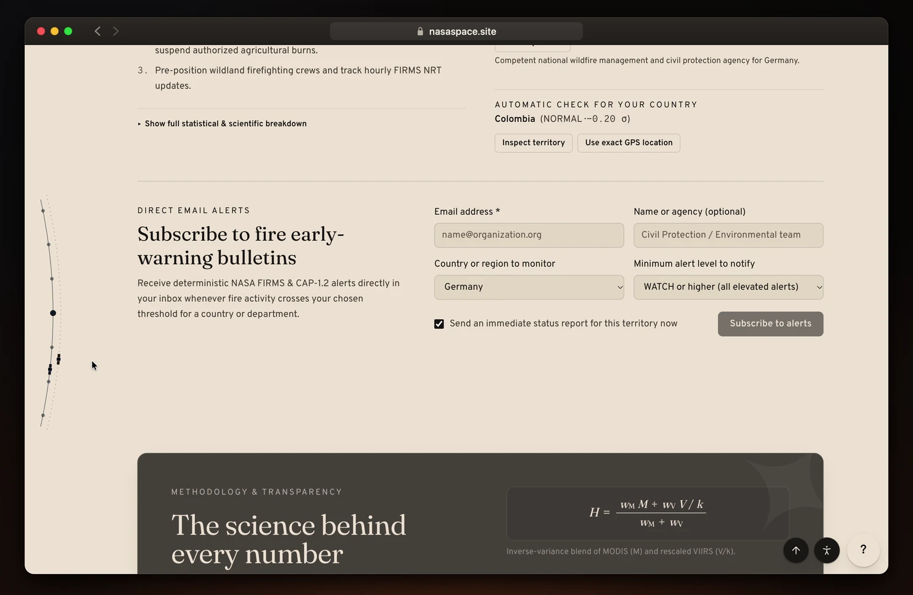</td>
</tr>
<tr>
<td align="center"><sub>Each territory: its typical fire season and most unusual months</sub></td>
<td align="center"><sub>Email early-warning bulletins by country or department</sub></td>
</tr>
<tr>
<td width="50%">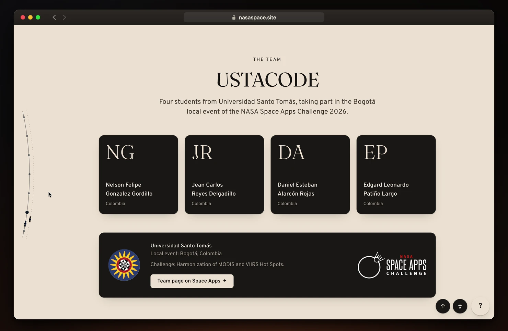</td>
<td width="50%">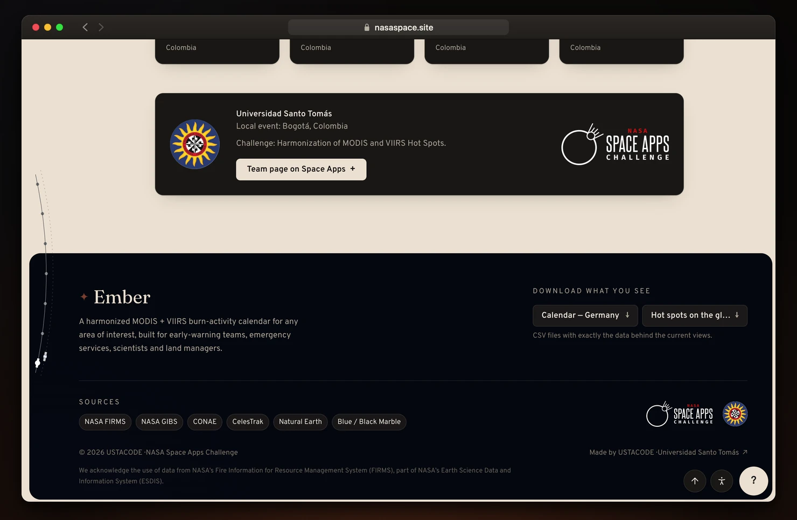</td>
</tr>
<tr>
<td align="center"><sub>Team USTACODE, Universidad Santo Tomás</sub></td>
<td align="center"><sub>Downloads of what is on screen, and every data source credited</sub></td>
</tr>
</table>

## 🛰️ Data sources

| Source | Used for |
|---|---|
| [**NASA FIRMS**](https://firms.modaps.eosdis.nasa.gov/) — MODIS C6.1 and VIIRS 375 m active fire (standard archive and near real time, [Area API](https://firms.modaps.eosdis.nasa.gov/api/area/)) | every detection, count and FRP value |
| [**NASA GIBS**](https://www.earthdata.nasa.gov/engage/open-data-services-software/earthdata-developer-portal/gibs-api) / [**Worldview**](https://worldview.earthdata.nasa.gov/) | satellite imagery of the selected day |
| [**NASA Blue Marble**](https://visibleearth.nasa.gov/collection/1484/blue-marble) / [**Black Marble**](https://earthobservatory.nasa.gov/features/NightLights) | Earth day and night textures |
| [**CONAE**](https://www.argentina.gob.ar/ciencia/conae) | author of the challenge |
| [**NOAA CPC — Oceanic Niño Index**](https://www.cpc.ncep.noaa.gov/data/indices/oni.ascii.txt) | El Niño / La Niña context |
| [**CelesTrak**](https://celestrak.org/) | satellite orbital elements (TLE) |
| [**Natural Earth**](https://www.naturalearthdata.com/) via [world-atlas](https://github.com/topojson/world-atlas) | country and subdivision boundaries |

<sub><i>We acknowledge the use of data from NASA's Fire Information for Resource Management System (FIRMS), part of NASA's Earth Science Data and Information System (ESDIS).</i></sub>

## 🛠️ Built with

<p>


<br>


<br>


</p>

## 🏗️ Architecture

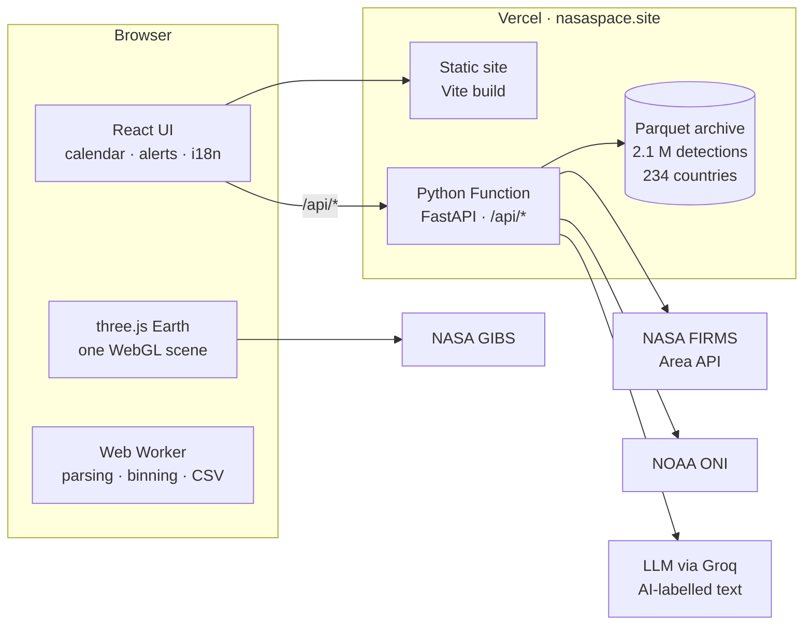

- **One domain, no CORS.** The Vite site and the FastAPI backend ship together on Vercel; `/api/*` is a Python Function bundled with the processed data.
- **One WebGL Earth.** The intro, the landing and the explorer share a single renderer; hotspots are one GPU draw call; frames render only while something moves.
- **Heavy work off the main thread.** Fetching, parsing, binning and CSV export run in a Web Worker; the 3D stack is lazy-loaded behind a ~120 KB first paint.
- **Graceful fallbacks.** Without WebGL2 or on low-memory devices the app switches to a 2D Equal Earth map.

Details: [developer guide → architecture](docs/development/setup.md#architecture).

## 🚀 Run it locally

```bash
git clone https://github.com/IngeNelsonG/NASA_CHALLENGE_2026.git
cd NASA_CHALLENGE_2026
npm install
npm run dev            # http://localhost:5173, with synthetic demo data
```

To use the real data, start the API (Python 3.12+ and [uv](https://docs.astral.sh/uv/)) and point the frontend at it:

```bash
cd backend && uv sync && uv run uvicorn brasa.main:app --port 8000
# in another terminal, from the repository root
cp .env.example .env.local && npm run dev
```

Environment variables, the API contract, deployment and CI are in the **[developer guide](docs/development/setup.md)**.

<details>
<summary><b>Repository layout</b></summary>

```text
.
├── src/                     React + TypeScript frontend
│   ├── app/                 shell, routing, data loaders, i18n (EN/ES)
│   ├── scenes/              the WebGL Earth: globe, hotspots, satellites, camera
│   ├── features/            landing, explorer, calendar, anomalies, methodology, assistant…
│   ├── lib/                 API client, worker, orbit propagation, colour scales
│   └── mocks/               synthetic backend for offline demos
├── backend/                 FastAPI service (package "brasa")
│   ├── src/brasa/           ingestion · harmonization · alerts · api
│   ├── data/                processed FIRMS archive (Parquet) and context layers
│   ├── scripts/             data pipeline
│   └── tests/               249 tests, coverage ≥ 80 % enforced
├── api/index.py             Vercel entry point for the backend
├── docs/
│   ├── development/         developer guide
│   ├── methodology/         scientific transparency document (ES)
│   └── assets/              screenshots and the tour GIF
├── public/                  textures, brand assets, favicon
└── .github/workflows/       CI/CD: checks on every PR, production deploy from main
```
</details>

## ✅ Quality, accessibility and honesty

- **CI/CD on every change.** Frontend type-check and build; backend `ruff`, `mypy` and `pytest` (249 tests, 90.8 % coverage, ≥ 80 % enforced). Production deploys only after every check passes.
- **Accessible.** Every control is keyboard-reachable with visible focus; the globe and the calendar have keyboard controls; the calendar has a table alternative for screen readers; `prefers-reduced-motion` is respected; English and Spanish.
- **Honest with data.** Missing observations are hatched, never zero. Uncertainty is always shown. A detection is a satellite pixel that saw fire at overpass time, not burned area and not a count of fires; the app says so. El Niño is context, never a cause.
- **Known limits.** Point-level detections are archived for Colombia; elsewhere the calendar uses monthly totals, with live FIRMS points for recent spans. Earth textures stop at 4K. Areas are rectangles, not free polygons.

## 🤖 Use of AI

- **Code and documentation.** The team used Claude (Anthropic) as a coding assistant for parts of the frontend, backend, tests, CI/CD configuration and documentation. Every change was reviewed, tested and deployed by the team.
- **In the app.** The help assistant and the period explanations are written at runtime by a large language model through the Groq API and are labelled **"Written by AI (Groq)"** on screen. Without the model, deterministic templates are used. Every number comes from the data, never from the model.
- **Demo video.** Real screen recording of the live site, narrated by a team member; the editing (subtitles, frame, QR code) was scripted with AI assistance.
- No AI-generated images, and no NASA logos or insignia were generated or modified.

## 👥 Team

<div align="center">

**USTACODE** · four students from Universidad Santo Tomás, at the Bogotá local event of the NASA Space Apps Challenge 2026.

| Nelson Felipe Gonzalez Gordillo | Jean Carlos Reyes Delgadillo | Daniel Esteban Alarcón Rojas | Edgard Leonardo Patiño Largo |
|:---:|:---:|:---:|:---:|

<br>

<a href="https://santototunja.edu.co/">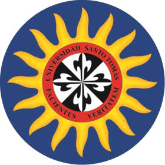</a>
&nbsp;&nbsp;&nbsp;&nbsp;&nbsp;
<a href="https://www.spaceappschallenge.org/2026/find-a-team/ustacode1/?tab=members"></a>

<br><br>

<sub>Independent hackathon project for the NASA Space Apps Challenge 2026; not an official NASA or CONAE product.</sub>

<br>

[⬆ Back to top](#ember)

</div>
